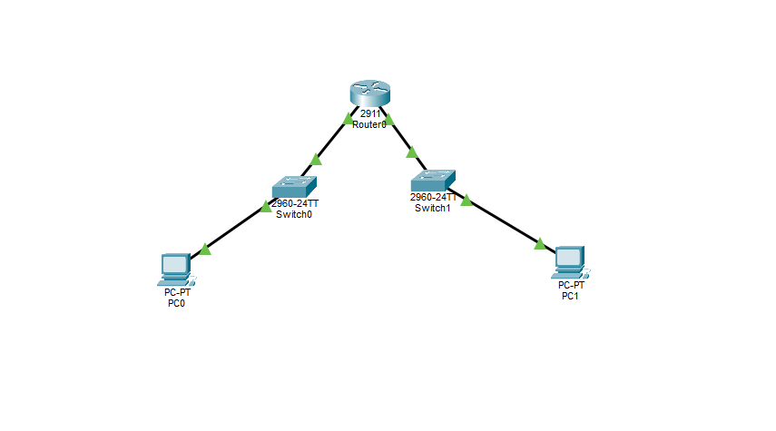

# Lab 02 — Connecting Two Networks with a Router

**Duration:** 30 min
**Goal:** Connect two separate networks (192.168.1.0/24 and 192.168.2.0/24) using a router and verify end-to-end connectivity.

## Theory

Lab 1 showed that PCs in different networks can't talk through a switch alone. A router solves this: it has one interface in each network and passes packets between them.

Every PC needs a **default gateway** — the answer to "if the destination is not local, who do I give the packet to?" The gateway is the router's IP on the PC's own network.

```
PC0 (192.168.1.10)  →  Router (192.168.1.1)  →  Router (192.168.2.1)  →  PC1 (192.168.2.10)
      Network A            gateway for A            gateway for B             Network B
```

How the packet travels:

1. PC0 sees the destination is in another network.
2. PC0 sends the packet to its gateway (the router).
3. The router looks at the destination IP, sees it has an interface in that network, and forwards it.
4. PC1 receives it.

The IP stays the same from start to finish, but the **MAC address changes at every hop**.

## Topology



```
  PC0 ── Switch0 ── R1 Gi0/0 ══ Gi0/1 ── Switch1 ── PC1
192.168.1.10      192.168.1.1  192.168.2.1      192.168.2.10
```

## IP Plan

| Device | Interface | IP | Mask | Gateway |
|--------|-----------|----|------|---------|
| PC0 | NIC | 192.168.1.10 | 255.255.255.0 | 192.168.1.1 |
| PC1 | NIC | 192.168.2.10 | 255.255.255.0 | 192.168.2.1 |
| R1 | Gi0/0 | 192.168.1.1 | 255.255.255.0 | n/a |
| R1 | Gi0/1 | 192.168.2.1 | 255.255.255.0 | n/a |

## Build

1. Add 1 router (2911), 2 switches (2960), and 2 PCs.
2. Connect with **Copper Straight-Through** cables:
   - PC0 → Switch0 → Router Gi0/0
   - PC1 → Switch1 → Router Gi0/1
3. Configure the PCs with the IPs and gateways from the table (Desktop > IP Configuration).
4. Open the router's CLI and paste the configuration from [r1-config.txt](r1-config.txt).
5. Test: from PC0, `ping 192.168.2.10`. (The first ping may time out because of ARP. Try again.)
6. On the router, run `show ip route` and look at the **C** (connected) entries.

## Troubleshooting story (real)

Initial pings from PC0 to PC1 failed with 100% packet loss. The diagnosis followed the troubleshooting ladder:

1. **Check the links** — all link lights green, so the cables were fine.
2. **Check `show ip route` on R1** — both networks showed as connected (`C 192.168.1.0/24` on Gi0/0, `C 192.168.2.0/24` on Gi0/1), so the router was fine.
3. **Check `ipconfig` on PC0** — showed `Default Gateway: 0.0.0.0` (empty). The gateway was missing on both PCs.
4. **The fix** — set the default gateway on both PCs (192.168.1.1 on PC0, 192.168.2.1 on PC1). Ping then worked.

First attempt also failed because of a typo: `ping 182.168.2.10` instead of `192.168.2.10` — a completely different (public) network. Always re-read the IP before troubleshooting.

Successful ping from PC0:

```
Request timed out.            <- ARP resolution on both networks
Reply from 192.168.2.10: bytes=32 time<1ms TTL=127
Reply from 192.168.2.10: bytes=32 time<1ms TTL=127
Reply from 192.168.2.10: bytes=32 time<1ms TTL=127
```

- The first packet is lost to **ARP**: PC0 resolves the gateway's MAC, the router resolves PC1's MAC. After that, everything is fast.
- **TTL=127**: PCs start at TTL 128, each router subtracts 1. 128 − 1 = 127 means the packet crossed exactly one router.

## Break it on purpose

Remove the default gateway from PC0 and ping 192.168.2.10 again.

**Why it fails:** PC0 knows 192.168.2.10 is not on its local network (192.168.1.0/24), but with no default gateway it has no device to hand the packet to. The packet never leaves the PC. ARP only works inside the local network — you cannot ARP for a remote host.

## Investigate (Simulation Mode)

Follow one ping across the router and compare MAC addresses:

| Hop | Source MAC | Dest MAC | IP |
|-----|-----------|----------|----|
| PC0 → Router | PC0's MAC | R1 Gi0/0's MAC | 192.168.1.10 → 192.168.2.10 |
| Router → PC1 | R1 Gi0/1's MAC | PC1's MAC | 192.168.1.10 → 192.168.2.10 |

**What changed:** both MAC addresses — the router rewrites them on each hop (it is a new Layer 2 frame).
**What stayed the same:** the IP addresses — they are end-to-end, never touched by the router.

## Mini quiz

1. **What does `Default Gateway: 0.0.0.0` mean?** — No gateway configured. The PC can only reach its own local network.
2. **If a reply came back with TTL=126, how many routers did it cross?** — Two (128 − 2 = 126).
3. **What changed at the router?** — MAC addresses (Layer 2 rewritten every hop); IPs (Layer 3) stay the same end-to-end.

## Security notes

The router is the checkpoint between networks. Right now it allows all traffic. In a later lab, **ACLs** will be used there to decide what is allowed to cross.

## Files

- `lab-02.pkt` — Packet Tracer topology
- `topology.png` — exported topology diagram
- `r1-config.txt` — router running configuration

## Tools

- [Cisco Packet Tracer](https://www.netacad.com/courses/packet-tracer)
