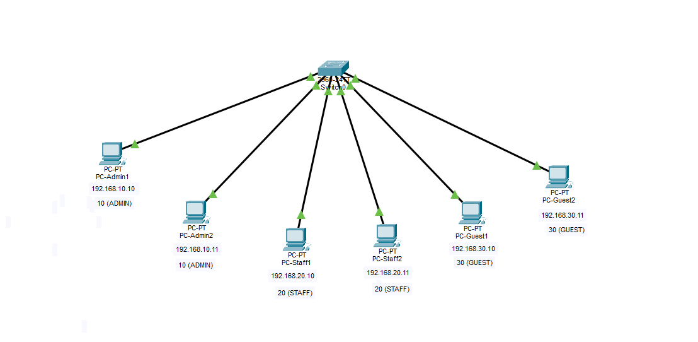

# Lab 03 — VLAN Segmentation

**Duration:** 30 min
**Goal:** Segment one switch into three isolated VLANs (Admin, Staff, Guest) and verify that traffic cannot cross between them.

No gateways are needed in this lab — there is no router yet.

## Topology



```
                 ┌──────────── SW1 (2960) ────────────┐
 PC-Admin1 ──────│ Fa0/1  VLAN 10 ADMIN   192.168.10.0/24 │
 PC-Admin2 ──────│ Fa0/2  VLAN 10 ADMIN                  │
 PC-Staff1 ──────│ Fa0/3  VLAN 20 STAFF   192.168.20.0/24 │
 PC-Staff2 ──────│ Fa0/4  VLAN 20 STAFF                  │
 PC-Guest1 ──────│ Fa0/5  VLAN 30 GUEST   192.168.30.0/24 │
 PC-Guest2 ──────│ Fa0/6  VLAN 30 GUEST                  │
                 └─────────────────────────────────────┘
```

## IP Plan

| Device | VLAN | IP | Mask | Switch port |
|--------|------|----|------|-------------|
| PC-Admin1 | 10 (ADMIN) | 192.168.10.10 | 255.255.255.0 | Fa0/1 |
| PC-Admin2 | 10 (ADMIN) | 192.168.10.11 | 255.255.255.0 | Fa0/2 |
| PC-Staff1 | 20 (STAFF) | 192.168.20.10 | 255.255.255.0 | Fa0/3 |
| PC-Staff2 | 20 (STAFF) | 192.168.20.11 | 255.255.255.0 | Fa0/4 |
| PC-Guest1 | 30 (GUEST) | 192.168.30.10 | 255.255.255.0 | Fa0/5 |
| PC-Guest2 | 30 (GUEST) | 192.168.30.11 | 255.255.255.0 | Fa0/6 |

## Build

1. Add 1 switch (2960) and 6 PCs. Connect with Copper Straight-Through cables to the ports in the table.
2. Set the IPs on each PC.
3. Open the switch CLI and paste the configuration from [sw1-config.txt](sw1-config.txt).
4. Verify with `show vlan brief` — each VLAN should show its two ports.

## Test results

| Test | Result |
|------|--------|
| Admin1 → Admin2 (same VLAN) | ✅ works — TTL=128, no router crossed |
| Staff1 → Staff2 (same VLAN) | ✅ works |
| Admin1 → Staff1 (cross VLAN) | ❌ fails, 100% loss — **this is the goal** |
| Guest1 → Admin1 (cross VLAN) | ❌ fails, 100% loss |

`show vlan brief` output:

```
VLAN Name                             Status    Ports
---- -------------------------------- --------- -------------------------------
1    default                          active    Fa0/7, Fa0/8, Fa0/9, Fa0/10,
                                                Fa0/11, Fa0/12, Fa0/13, Fa0/14,
                                                Fa0/15, Fa0/16, Fa0/17, Fa0/18,
                                                Fa0/19, Fa0/20, Fa0/21, Fa0/22,
                                                Fa0/23, Fa0/24, Gig0/1, Gig0/2
10   ADMIN                            active    Fa0/1, Fa0/2
20   STAFF                            active    Fa0/3, Fa0/4
30   GUEST                            active    Fa0/5, Fa0/6
1002 fddi-default                     active
1003 token-ring-default               active
1004 fddinet-default                  active
1005 trnet-default                    active
```

The unused ports (Fa0/7-24) are still in VLAN 1 (default). In a real network, unused ports should be shut down and moved to an unused VLAN — VLAN 1 is a common attack target. (VLANs 1002-1005 are legacy; ignore them.)

## Break it on purpose

Move Fa0/2 to VLAN 30:

```
interface fa0/2
 switchport access vlan 30
```

Now Admin1 can't reach Admin2 — Fa0/1 is in VLAN 10 and Fa0/2 is in VLAN 30, so they're isolated even though both are "Admin" PCs. `show vlan brief` reveals the problem. Fix: `switchport access vlan 10` on Fa0/2.

## Why TTL=128 here but 127 in Lab 2

Lab 2 had a router (R1): each router crossed subtracts 1 from TTL (128 → 127). Lab 3 has no router, so nothing is subtracted. TTL drops per router crossed, not per interface — R1 had two interfaces but the packet crossed it only once.

## Think about it

**What would you need so Staff could reach a server in Admin, but Guests still couldn't?**

A server placed inside VLAN 10 (e.g. 192.168.10.12) is reachable by Admin PCs only — Staff in VLAN 20 still can't reach it. The real solution is a **router that connects the VLANs**, plus **rules (ACLs)** that say who may cross:

- Staff → Admin server: allowed
- Guest → Admin server: blocked

That's **inter-VLAN routing** (Lab 4, "router-on-a-stick") and the rules are **ACLs** (Lab 5).

## Quiz answers

1. **Why was TTL 128 in Lab 3 but 127 in Lab 2?** — No router in Lab 3; TTL only drops when a router is crossed (Lab 2 had one router crossed, 128 → 127).
2. **If Guest1 is plugged into Fa0/7 (VLAN 1), can it ping Guest2 in VLAN 30?** — No. The VLAN decides who can talk, not the IP alone; VLAN 1 and VLAN 30 are separate broadcast domains.
3. **Do two different VLANs need two different subnets?** — Yes. A VLAN is one broadcast domain = one network. From Labs 1-2: same network = talk directly, different network = need a router. Each VLAN gets its own subnet so traffic between them must go through a router — that's exactly why inter-VLAN routing exists.

## Security notes

- VLANs limit the blast radius of a compromised device.
- Unused ports should be shut down and moved out of VLAN 1.
- VLAN hopping is a known attack; mitigations come in a later lab.

## Files

- `lab-03.pkt` — Packet Tracer topology
- `topology.png` — exported topology diagram
- `sw1-config.txt` — switch running configuration

## Tools

- [Cisco Packet Tracer](https://www.netacad.com/courses/packet-tracer)
