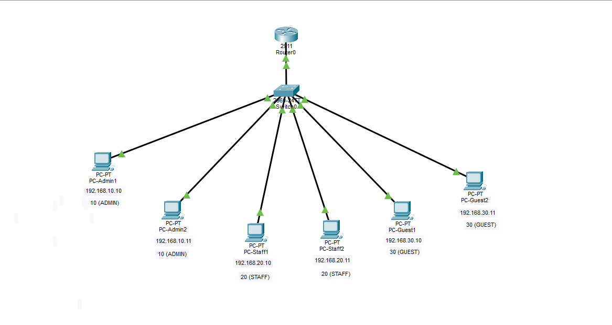

# Lab 04 — Inter-VLAN Routing (Router-on-a-Stick)

**Duration:** 35 min
**Goal:** Let VLAN 10 and VLAN 20 talk through a router, and watch the TTL drop.

## Theory

Lab 3 made the VLANs isolated — great for security, but Staff can't reach anything in Admin even when they should. The solution is a controlled bridge between VLANs: **router-on-a-stick**.

- **Trunk port:** one cable carries traffic for many VLANs. Each frame gets an 802.1Q tag saying which VLAN it belongs to.
- **Subinterfaces:** the router splits one physical port into virtual ones, one per VLAN. Each becomes the default gateway of its VLAN.

```
PC (VLAN 10) → Switch → [trunk cable] → Router (Gi0/0.10 = gateway for VLAN 10)
                                         Router (Gi0/0.20 = gateway for VLAN 20)
```

Analogy: one elevator (the trunk) serving all floors, with a receptionist (the router) who decides which floors may visit each other.

### What is the purpose of a trunk?

Without a trunk, the router would need one cable/port per VLAN:

```
Switch Fa0/1 (VLAN 10) ---- cable ---- Router Gi0/0
Switch Fa0/2 (VLAN 20) ---- cable ---- Router Gi0/1
Switch Fa0/3 (VLAN 30) ---- cable ---- Router Gi0/2
```

3 VLANs = 3 cables, 3 switch ports, 3 router ports. With 50 VLANs, that's impossible.

With a trunk: **one cable** carries VLAN 10, 20 and 30, kept separate by 802.1Q tagging:

```
[Frame from Admin1] → switch adds tag "VLAN 10" → travels on the trunk
                      → router reads the tag → uses Gi0/0.10
```

Trunks also connect **switch to switch**, letting one VLAN exist on multiple floors even with separate hardware. Analogy: a highway with colored lanes — all cars share one road, but each car's color tag tells it which exit to take.

## Topology



Reuses Lab 3 (saved as lab-04.pkt) plus 1 router (2911). SW1 Gi0/1 → Router Gi0/0 (trunk).

## IP plan (gateways)

| VLAN | Router subinterface | IP | PC gateway |
|------|---------------------|----|-----------|
| 10 | Gi0/0.10 | 192.168.10.1 | 192.168.10.1 |
| 20 | Gi0/0.20 | 192.168.20.1 | 192.168.20.1 |
| 30 | Gi0/0.30 | 192.168.30.1 | 192.168.30.1 |

## Build

1. Reuse Lab 3 (save it as lab-04.pkt). Add 1 router (2911). Connect SW1 Gi0/1 → Router Gi0/0.
2. **Step 1:** set the gateways on all 6 PCs (remember Lab 2!).
3. **Step 2 — switch CLI:** make Gi0/1 a trunk ([sw1-trunk-config.txt](sw1-trunk-config.txt)).
4. **Step 3 — router CLI:** create the subinterfaces ([r1-config.txt](r1-config.txt)).
5. **Step 4 — verify:**
   - `show ip route` on R1: three connected networks.
   - `show interfaces trunk` on SW1: Gi0/1 listed as a trunk.
   - From PC-Admin1: `ping 192.168.20.10` — works now, **TTL=127**.

TTL went from 128 (Lab 3, same VLAN, no router) to 127 (crossing R1) — the packet crossed exactly one router.

## Break it on purpose

Change `encapsulation dot1Q 20` to `dot1Q 99` on the router and see what happens to VLAN 20.

**What happens:** VLAN 20 PCs lose their gateway. Frames tagged VLAN 20 arrive at the router, but no subinterface claims tag 20 — they are dropped. Admin1 → Staff1 fails again.

**Find the fault:** `show ip interface brief` and `show running-config` — the subinterface Gi0/0.20 is tagging VLAN 99 instead of 20. **Fix:** `encapsulation dot1Q 20`.

## Think about it

Now that routing works, **Guests can reach Admin too** — that's bad! What do we need to block it?

Something that checks traffic **at the router** and decides what may cross. That's an **ACL** — Lab 5.

## Quick check

**If a company had 5 VLANs and no trunk, how many cables between switch and router? With a trunk?**

- No trunk: 5 cables (one per VLAN).
- With a trunk: 1 cable.

## Security angle

The trunk is a high-value target — attackers try **VLAN hopping** to jump between VLANs. Good practice: allow only needed VLANs on the trunk (`switchport trunk allowed vlan ...`) and never leave ports in automatic trunk negotiation (disable DTP). Hardening comes in a later lab.

## Files

- `lab-04.pkt` — Packet Tracer topology
- `topology.png` — exported topology diagram
- `sw1-trunk-config.txt` — trunk configuration for SW1
- `r1-config.txt` — router subinterface configuration

## Tools

- [Cisco Packet Tracer](https://www.netacad.com/courses/packet-tracer)
