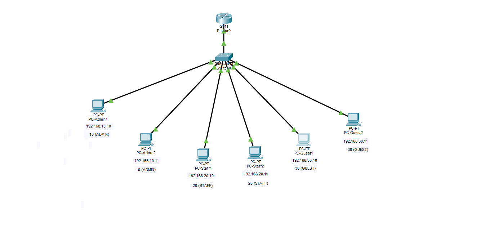
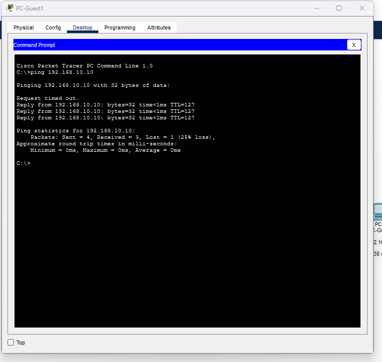
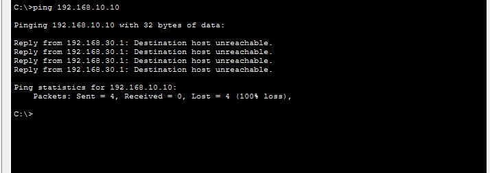

# Lab 05 — Access Control Lists (ACLs)

**Duration:** 30 min
**Goal:** Block the Guest VLAN from reaching Admin and Staff while keeping the rest of the network working.

Builds on Lab 4 (saved as lab-05.pkt). Router-only lab.

## Theory

An ACL is a list of rules on a router. For each packet the router asks: "allow or block?" — like a security guard with a checklist at the door.

**3 rules you must remember:**

1. The router reads the list **top to bottom and stops at the first match**. Order matters.
2. Every ACL ends with a **hidden `deny all`**. If no rule matches, the packet is blocked. That's why we add `permit ip any any` at the end when we only want to block specific things.
3. An ACL **does nothing until you apply it to an interface**, and you must choose a direction:
   - `in` = traffic entering the router through that interface
   - `out` = traffic leaving through it

**Wildcard mask** — the inverse of a subnet mask:

| Subnet mask | Wildcard mask | Meaning |
|-------------|---------------|---------|
| 255.255.255.0 | 0.0.0.255 | First 3 numbers must match, the last can be anything |

`0` = must match, `255` = don't care.

**Where to place it:** an extended ACL (checks source and destination) goes as close to the source as possible. Our source is the Guest VLAN, so it is applied on Gi0/0.30, inbound. Blocked traffic dies immediately.

## Topology



Same topology as Lab 4: VLANs 10/20/30 on SW1, trunk to R1, subinterfaces acting as gateways.

## Configuration

Extended ACL `GUEST-IN` applied inbound on Gi0/0.30. Full config in [r1-config.txt](r1-config.txt).

```
ip access-list extended GUEST-IN
 deny ip 192.168.30.0 0.0.0.255 192.168.10.0 0.0.0.255
 deny ip 192.168.30.0 0.0.0.255 192.168.20.0 0.0.0.255
 permit ip any any
exit
interface gigabitEthernet 0/0.30
 ip access-group GUEST-IN in
```

## Verification

`show access-lists` after a few pings:

```
Extended IP access list GUEST-IN
10 deny ip 192.168.30.0 0.0.0.255 192.168.10.0 0.0.0.255
20 deny ip 192.168.30.0 0.0.0.255 192.168.20.0 0.0.0.255
30 permit ip any any
```

> Note: Packet Tracer doesn't always show the `(N match(es))` counters. On real Cisco gear they appear there and are used to prove a rule is catching traffic.

`show ip interface gigabitEthernet 0/0.30` confirms the ACL is applied:

```
Inbound access list is GUEST-IN
```

That line is the important one — an ACL that is created but not applied does nothing.

### Before vs after

**Before** — Guest1 → Admin1 succeeds:



**After** — Guest1 → Admin1 blocked by the router:



```
Reply from 192.168.30.1: Destination host unreachable.
```

Notice **who** replies: the router (192.168.30.1, the Guest gateway) saying "I blocked it." That is different from a plain timeout:

| Message | Meaning |
|---------|---------|
| `Request timed out` | The packet was lost or nobody replied (cable, gateway, ARP, silent firewall) |
| `Destination host unreachable` from the gateway | The router actively refused it (ACL or no route) |

### Test results

| From | To | Expected | Result |
|------|----|----------|--------|
| Guest1 | Admin1 (192.168.10.10) | Blocked | ✅ Destination host unreachable |
| Guest1 | Staff1 (192.168.20.10) | Blocked | ✅ |
| Guest1 | Guest2 (192.168.30.11) | Works (same VLAN, never reaches the router) | ✅ |
| Admin1 | Staff1 | Works | ✅ |
| Staff1 | Admin1 | Works | ✅ |

## Why do we need `permit ip any any` at the end?

Because of the hidden `deny all`. Without it, every other packet from Guests — traffic to the other Router interfaces, internet access later, even pings to their own gateway — would also be blocked. The final permit says: *block only what I listed, allow the rest.*

## Break it on purpose

Put `permit ip any any` **before** the two deny lines (delete and recreate the ACL, since new rules are added at the bottom). Guests can reach Admin again — the router stops at the **first match**, so the permit swallows everything and the deny lines are never evaluated. That's why order matters.

## Challenge

**What would you change so Guests can still ping a printer at 192.168.30.50 but nothing else outside their VLAN?**

Nothing — the printer at `192.168.30.50` is **inside VLAN 30**. Traffic between two hosts in the same VLAN never reaches the router, so the ACL on Gi0/0.30 is never consulted. It keeps working automatically.

(If the printer were outside VLAN 30, you would add an explicit permit above the deny lines, e.g. `permit ip 192.168.30.0 0.0.0.255 host <printer-ip>`.)

## What I learned

- ACLs are read top to bottom; the first match wins — order matters.
- Every ACL has a hidden `deny all` at the end.
- Wildcard masks are the inverse of subnet masks.
- Creating an ACL is not enough: it must be applied to an interface with a direction.

## Security notes

- Segmentation (VLANs) + filtering (ACLs) = defense in depth.
- ACLs placed close to the source save bandwidth — traffic is dropped before crossing the network.
- The router is the checkpoint between networks; this is where policy lives.

## Files

- `lab-05.pkt` — Packet Tracer topology
- `topology.png` — exported topology diagram
- `before-ping.png` — Guest1 → Admin1 succeeds (before the ACL)
- `after-ping.png` — Guest1 → Admin1 blocked (after the ACL)
- `r1-config.txt` — router configuration including the ACL

## Tools

- [Cisco Packet Tracer](https://www.netacad.com/courses/packet-tracer)
