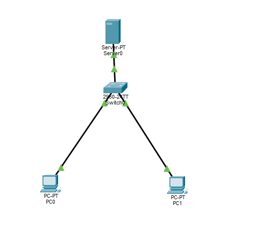

# Lab 06 — DHCP, DNS and HTTP (Mini Internet)

**Duration:** 30 min
**Goal:** Build a small network where hosts receive IP settings automatically via DHCP and reach a web server by name using DNS.

## Theory

Two services fix the "type every IP" problem: **DHCP** (automatic addressing) and **DNS** (name resolution). A web server (HTTP) lets us test both.

### DHCP (Dynamic Host Configuration Protocol)

A server that gives IP settings automatically: IP address, subnet mask, default gateway, and DNS server. It works in 4 steps, called **DORA**:

| Step | Name | What happens |
|------|------|-------------|
| 1 | **D**iscover | The new PC broadcasts "Is there a DHCP server? I need an IP!" (255.255.255.255) — it has no IP yet. |
| 2 | **O**ffer | The DHCP server offers an IP (e.g. 192.168.1.100). |
| 3 | **R**equest | The PC requests that specific IP. |
| 4 | **A**cknowledge | The server confirms the lease (IP, mask, gateway, DNS). |

DHCP only works inside the same network unless a router is configured for DHCP relay.

### DNS (Domain Name System)

The "phone book" of the internet. When you type `www.mylab.com`, DNS translates it to an IP. The PC then connects to that IP. DNS answers come from the DNS server configured by DHCP or manually.

### HTTP (Web Server)

A web server listens on **port 80** and serves a web page to any client that requests it.

## Security notes

- **Rogue DHCP server:** an attacker hands out their IP as the gateway so traffic goes through them.
- **DNS spoofing:** an attacker makes `www.mylab.com` resolve to a fake site.
- **APIPA abuse / starvation:** if many PCs show `169.254.x.x`, DHCP may be down or under attack (DHCP starvation).

## Topology

## IP plan

| Device | IP | How |
|--------|----|-----|
| Server0 | 192.168.1.2 / 255.255.255.0 | Static (servers must not change IP) |
| PC0, PC1 | 192.168.1.100+ (from pool) | DHCP (automatic) |

The DHCP pool starts at .100 so it never gives out .2 (avoiding IP conflicts). Default gateway set to 192.168.1.1 as good practice.

## Build

1. Add 1 switch (2960), 1 Server (Server-PT), and 2 PCs. Connect with Copper Straight-Through cables.
2. Save as `lab-06.pkt`.

## Server0 configuration

### A) Static IP (Desktop > IP Configuration)
- IPv4 Address: `192.168.1.2`
- Subnet Mask: `255.255.255.0`
- DNS Server: `192.168.1.2` (the server uses itself)

### B) DHCP (Services > DHCP)
- Service: **On**
- Pool Name: `LAB-POOL`
- Default Gateway: `192.168.1.1`
- DNS Server: `192.168.1.2`
- Start IP Address: `192.168.1.100`
- Subnet Mask: `255.255.255.0`
- Maximum Number of Users: `50`
- Click **Save**

> In Packet Tracer there can be a default `serverPool`. If PCs get unexpected IPs/gateways, edit the active pool (or replace `serverPool` with your values) and run `ipconfig /renew`.

### C) DNS (Services > DNS)
- Service: **On**
- Name: `www.mylab.com`
- Type: **A Record** (maps name to IPv4)
- Address: `192.168.1.2`
- Click **Add**

### D) HTTP (Services > HTTP)
- HTTP: **On**
- Edit `index.html` to a custom welcome page (e.g. `Welcome to my first network, built by Anthony!`) and save.

## PC configuration

On each PC: **Desktop > IP Configuration > DHCP**. Wait a few seconds for the lease.

## Verification

From PC0 Command Prompt:

| Command | Result |
|---------|--------|
| `ipconfig` | IP starts at 192.168.1.100, mask 255.255.255.0, gateway 192.168.1.1, DNS 192.168.1.2 |
| `ipconfig /renew` | Renews the lease (often gets the same IP by MAC). |
| `nslookup www.mylab.com` | `Server: 192.168.1.2`, answer `Name: www.mylab.com` → `Address: 192.168.1.2` |
| `ping www.mylab.com` | Resolves by DNS to 192.168.1.2, 4 replies, TTL=128 (same network) |

Web Browser: `http://www.mylab.com` → loads the custom page.

**DORA observed in Simulation Mode:** Discover → Offer → Request → Acknowledge. Discover is a broadcast to `255.255.255.255`.

## Troubleshooting

PC0 initially received `192.168.1.1` with gateway `0.0.0.0`. The server's default pool (`serverPool`) was answering instead of `LAB-POOL`. I edited the active DHCP pool with the correct values (gateway 192.168.1.1, DNS 192.168.1.2, start 192.168.1.100), saved, ran `ipconfig /renew`, and it got `192.168.1.100` correctly.

## Quick answers

- **D in DORA = Discover.** The PC broadcasts to find a DHCP server (it has no IP yet). DNS is different — DHCP gives IP settings, DNS translates names to IPs.
- **DNS** turns `www.mylab.com` into `192.168.1.2`.
- **169.254.x.x (APIPA)** means no DHCP server answered — the PC assigned itself an address. Could be DHCP off/broken, pool full, cable/VLAN issue, or no DHCP relay. Start close and move outward.

## Files

- `lab-06.pkt` — Packet Tracer topology
- `topology.png` — exported topology diagram

## Tools

- [Cisco Packet Tracer](https://www.netacad.com/courses/packet-tracer)
