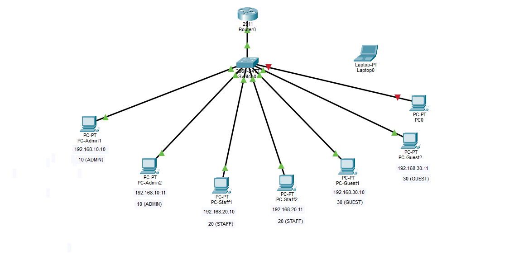

# Lab 07 — Port Security

**Duration:** 30 min
**Goal:** Restrict each access port to a known device and lock down unused ports.

## Theory

Anyone can plug a laptop into a free wall port and join the network. Port security says: *"This port only accepts specific MAC addresses. If anyone else appears, react."*

### Key terms

- **Maximum 1:** only 1 MAC address allowed on the port.
- **Sticky:** the switch learns the first MAC it sees and remembers it (saved in the running config) — no need to type MACs manually.
- **Violation modes:**
  | Mode | Behavior |
  |------|----------|
  | **shutdown (default)** | Port goes err-disabled until an admin re-enables it. Strongest. |
  | **restrict** | Drops bad traffic, keeps the port up, logs and counts violations. |
  | **protect** | Silently drops bad traffic. No log, no alert. |

We use **shutdown** in this lab.

### Unused ports

Best practice: move unused ports to a "black hole" VLAN and shut them down. Even if someone plugs in, nothing happens. In Lab 3, unused ports sat in VLAN 1 — here we move them to VLAN 999 and `shutdown` them.

### Security angle

Port security defends against **rogue devices** and **MAC flooding**. It does **not** stop **MAC spoofing** (copying a legitimate MAC address). It's one layer, not the whole defense.

## Topology



Builds on Lab 4. Add a **Laptop (ROGUE)** for the intruder test. Admin1/Admin2/Staff/Guest PCs are on Fa0/1-6; Fa0/7-24 are locked down.

## Configuration

See [sw1-config.txt](sw1-config.txt).

```text
vlan 999
 name UNUSED
exit
interface range fastEthernet 0/1-6
 switchport mode access
 switchport port-security
 switchport port-security maximum 1
 switchport port-security mac-address sticky
 switchport port-security violation shutdown
exit
interface range fastEthernet 0/7-24
 switchport mode access
 switchport access vlan 999
 shutdown
end
write memory
```

> Do **not** enable port security on the trunk port (Gi0/1 to the router). A trunk carries many MAC addresses from different VLANs/devices — with `maximum 1` it would immediately violate and shut down, cutting the whole inter-VLAN network.

## Verification

1. **Let the switch learn.** Ping between PCs so sticky learns their MACs.
   - `show port-security` — summary of all secured ports
   - `show port-security interface fastEthernet 0/1` — details (max, mode, status)
   - `show port-security address` — learned MACs
   - `show running-config` — should show `switchport port-security mac-address sticky <MAC>` saved

2. **Intruder test.** Replace Admin1 with a rogue laptop on Fa0/1 (IP 192.168.10.99), ping 192.168.10.11.

   Output:

   ```text
   Pinging 192.168.10.11 with 32 bytes of data:
   Request timed out.
   Request timed out.
   Request timed out.
   Request timed out.
   ```

   `show port-security interface fastEthernet 0/1`:

   ```text
   Port Security              : Enabled
   Port Status                : Secure-shutdown
   Violation Mode             : Shutdown
   Maximum MAC Addresses      : 1
   Total MAC Addresses        : 1
   Sticky MAC Addresses       : 1
   Last Source Address:Vlan   : 0060.3E82.A1A5:10
   Security Violation Count   : 1
   ```

   The link light turns red and the port goes **err-disabled**. The `Last Source Address` shows the MAC of the device that triggered the violation (the rogue laptop).

3. **Recover.** Reconnect Admin1 to Fa0/1. The port is still shut down and sticky still remembers Admin1's MAC.

   ```text
   configure terminal
   interface fastEthernet 0/1
    shutdown
    no shutdown
   end
   ```

   `shutdown` followed by `no shutdown` resets the err-disabled port. Admin1 works again.

4. **Unused port test.** Plug a PC into Fa0/10 — the link stays down because the port is `shutdown` and in VLAN 999.

## Answers

1. **What does `maximum 1` do?** It allows only 1 MAC address on the port. If a second, different MAC appears, it's a violation.
2. **Difference between `shutdown` and `restrict`?**
   - `shutdown` — blocks traffic and turns the port off (err-disabled) until an admin resets it.
   - `restrict` — drops bad traffic but keeps the port up, logs and counts violations. `shutdown` is stronger but can be abused for DoS; `restrict` avoids knocking a legitimate user offline.
3. **Why not enable port security on the trunk port?** A trunk carries traffic from many MAC addresses (all VLANs/devices across the link). With `maximum 1`, the second MAC would trigger a violation and shut the trunk down, cutting connectivity for the entire network.
4. **Attack where someone copies Admin1's MAC address?** **MAC spoofing.** Port security cannot tell the difference between the real device and a spoofed one — this is why it's only one layer of defense.

## What I learned

- Port security with sticky learns and locks a port to a known MAC.
- `violation shutdown` is aggressive but effective for catching intruders.
- Unused ports must be moved out of VLAN 1, put in a black hole VLAN (999), and shut down.
- Trunks must never use access-port style port security.

## Security notes

- Defends against rogue devices and MAC flooding.
- Does not stop MAC spoofing.
- Moving unused ports to VLAN 999 + shutdown reduces the attack surface.

## Files

- `lab-07.pkt` — Packet Tracer topology
- `topology.png` — exported topology diagram
- `sw1-config.txt` — switch configuration

## Tools

- [Cisco Packet Tracer](https://www.netacad.com/courses/packet-tracer)
