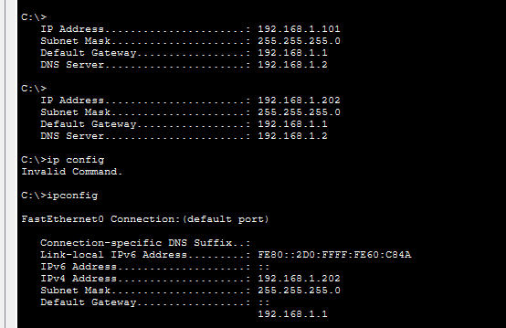
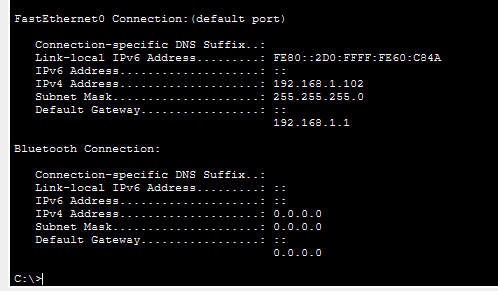

# Lab 08 — DHCP Snooping (Rogue DHCP Server Defense)

**Duration:** 35 min
**Goal:** Demonstrate a rogue DHCP server attack and mitigate it with DHCP snooping.

## Theory

In Lab 6, DHCP trusted anyone. The first Offer wins, so an attacker can plug in a rogue DHCP server and answer with:

- **Their own IP as the default gateway** — all traffic goes through the attacker (Man-in-the-Middle)
- **Their own DNS server** — e.g. `www.mybank.com` can point to a fake site

The solution is **DHCP snooping**: the switch sorts ports into trusted/untrusted.

| Port type | Meaning | Allowed to send DHCP Offers/Acks? |
|-----------|---------|-----------------------------------|
| **Trusted** | Leads to the real DHCP server (or uplink) | ✅ Yes |
| **Untrusted (default)** | PCs, laptops, anything else | ❌ No — the switch drops them |

Two extra features used here:

- **Binding table** — records each valid lease the switch sees (MAC, IP, VLAN, port). Used by **Dynamic ARP Inspection** in Lab 9.
- **Rate limit** — caps DHCP packets per second on a port to blunt **DHCP starvation** (flooding Discovers with fake MACs until the pool is empty).

## Topology


## IP plan

| Device | Switch port | IP | Role |
|--------|-------------|----|------|
| Server0 | Fa0/1 | 192.168.1.2 (static) | Real DHCP/DNS/HTTP server |
| PC0 | Fa0/2 | DHCP | Victim |
| PC1 | Fa0/3 | DHCP | Victim |
| Server1 (ROGUE) | Fa0/4 | 192.168.1.66 (static) | Fake DHCP server |

## Attack (before snooping)

The rogue server was configured with:

- DHCP pool starting at `192.168.1.200`
- **Default Gateway:** `192.168.1.66` (the attacker)
- **DNS Server:** `192.168.1.66`

Sometimes the rogue won and handed out a lease with its own gateway/DNS, enabling MITM/DNS spoofing.



## Defense (DHCP snooping)

On the switch:

```text
ip dhcp snooping
ip dhcp snooping vlan 1
interface fastEthernet 0/1
 ip dhcp snooping trust
exit
interface range fastEthernet 0/2-4
 ip dhcp snooping limit rate 10
end
write memory
```

- `ip dhcp snooping` — enables globally
- `ip dhcp snooping vlan 1` — enables for VLAN 1
- `Fa0/1` is **trusted** (real server)
- `Fa0/2-4` are **untrusted** with `limit rate 10` pps

## Verification

`show ip dhcp snooping`:

```text
Switch DHCP snooping is enabled
DHCP snooping is configured on following VLANs: 1
Insertion of option 82 is enabled
Option 82 on untrusted port is not allowed
Verification of hwaddr field is enabled
Interface Trusted Rate limit (pps)
----------------------- ------- ----------------
FastEthernet0/1 yes unlimited
FastEthernet0/2 no 10
FastEthernet0/3 no 10
FastEthernet0/4 no 10
```

The binding table after renewing leases:

```text
Switch#show ip dhcp snooping binding
MacAddress          IpAddress       Lease(sec)  Type           VLAN Interface
------------------  --------------- ---------- ------------- ---- -----------------
00:D0:FF:60:C8:4A   192.168.1.102   86400       dhcp-snooping 1    FastEthernet0/2
00:30:A3:73:33:C7   192.168.1.100   86400       dhcp-snooping 1    FastEthernet0/3
Total number of bindings: 2
```

PCs now get correct leases from the **real** server only. The rogue on Fa0/4 has no bindings.

After snooping:



PCs received IPs in the real range with **gateway 192.168.1.1** and **DNS 192.168.1.2**.

## Answers

1. **Trusted vs untrusted:** A trusted port is allowed to send DHCP server messages (Offers/Acks). Untrusted ports are not — the switch drops any DHCP server messages coming from them.
2. **Why is the rogue gateway dangerous?** If a PC gets its gateway from the rogue server, all traffic to other networks goes through the attacker. This enables **man-in-the-middle (MITM)** and the rogue DNS can redirect sites like `www.mybank.com` to fake pages.
3. **What does the binding table record?** MAC address, IP address, lease time, type, VLAN, and interface — "who got what, and where".
4. **DHCP starvation:** Attackers send thousands of Discover messages with fake MACs to empty the pool. Real users get **APIPA (169.254.x.x)**. The command `ip dhcp snooping limit rate 10` helps by limiting DHCP packets per second on untrusted ports and blunting the flood.

## Break it on purpose (note)

Removing `ip dhcp snooping trust` from Fa0/1 blocks the real server too — both become untrusted and no one gets a lease (APIPA). This is a real misconfiguration that can take down DHCP for an entire office.

## What I learned

- DHCP trusts the first answer by default — dangerous.
- Trust **only** the port toward the real DHCP server.
- The snooping binding table is essential for Dynamic ARP Inspection (Lab 9).
- Rate limiting helps against DHCP starvation.

## Security notes

- Trust only necessary ports.
- The binding table is a source of truth for later controls.
- Misconfigured trust can cause a full DHCP outage.

## Files

- `lab-08.pkt` — Packet Tracer topology
- `topology.png` — exported topology diagram
- `before-after.png` — rogue winning vs later state
- `ipconfig-after.png` — clean leases after snooping
- `sw1-config.txt` — switch configuration

## Tools

- [Cisco Packet Tracer](https://www.netacad.com/courses/packet-tracer)
