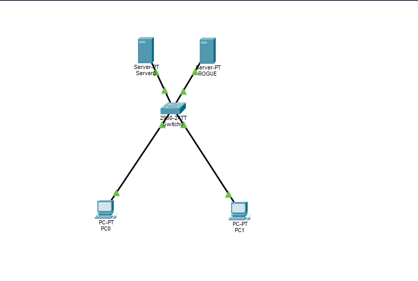

# Lab 09 — Dynamic ARP Inspection (DAI)

**Duration:** 35 min
**Goal:** Use the DHCP snooping binding table to validate ARP packets.

## Theory

ARP has no authentication. Any device can say “I am IP X, my MAC is Y” and other PCs will update their ARP tables — this is **ARP spoofing/poisoning**. An attacker can impersonate the gateway and do a **Man-in-the-Middle (MITM)** attack.

**Dynamic ARP Inspection (DAI)** checks every ARP packet on untrusted ports against the **DHCP snooping binding table** (Lab 8):

- Match → allowed
- No match → dropped and logged

DAI needs DHCP snooping enabled first. Ports toward servers/routers are **trusted** (ARP not checked). Everything else is **untrusted** (ARP checked).

**Note on static IPs:** Devices with static IPs won't be in the binding table, so DAI would block their ARP. They need a trusted port or an ARP ACL.

## Topology



Builds on Lab 8: Server0 (Fa0/1), PC0 (Fa0/2), PC1 (Fa0/3), ROGUE (Fa0/4). PCs keep their DHCP leases.

## Configuration

DAI enabled for VLAN 1. Fa0/1 trusted (Server0 has a static IP). Fa0/2-4 untrusted.

```text
ip arp inspection vlan 1
interface fastEthernet 0/1
 ip arp inspection trust
exit
interface range fastEthernet 0/2-4
 ip arp inspection limit rate 15
end
write memory
```

> **Packet Tracer limitation:** `ip arp inspection limit rate 15` was not accepted on the 2960 image used. Core DAI (`ip arp inspection vlan 1` and `ip arp inspection trust`) was accepted. The rate limit would stop ARP floods on real hardware, but was skipped here.

## Verification

`show ip arp inspection`:

```text
Source Mac Validation      : Enabled
Destination Mac Validation : Enabled
IP Address Validation      : Enabled

Vlan     Configuration    Operation
----     -------------    ---------
   1     Enabled          Active

Vlan     Forwarded        Dropped         DHCP Drops      ACL Drops
----     ---------        -------         ----------      ---------
   1     2                0               0               0

Vlan   DHCP Permits    ACL Permits    Probe Permits   Source Mac Failures   Dest Mac Failures   IP Validation Failures
----   ------------    -----------    -------------   -------------------   -----------------   -----------------------
   1              0              0               0                     0                   0                       0
```

`show ip arp inspection interfaces`:

```text
Interface        Trust State    Rate (pps)    Burst Interval
---------------- -----------    ----------    --------------
FastEthernet0/1    Trusted           15              1
FastEthernet0/2    Untrusted         15              1
FastEthernet0/3    Untrusted         15              1
FastEthernet0/4    Untrusted         15              1
```

`show ip dhcp snooping binding` showed the PCs matched to their ports (192.168.1.102 on Fa0/2, 192.168.1.100/102 depending on renewals) — exactly what DAI checks against.

Normal traffic worked: PC0 could ping PC1 and Server0.

## Spoofing test (mismatch)

I set PC1 to a **static IP 192.168.1.50** (no DHCP lease on its port). Pinging 192.168.1.101 from PC1 still succeeded and the DAI counters stayed at 0:

```text
Pinging 192.168.1.101 with 32 bytes of data:
Reply from 192.168.1.101: bytes=32 time<1ms TTL=128
...
Packets: Sent = 4, Received = 4, Lost = 0 (0% loss)
```

After the test, PC1 was set back to **DHCP** and `ipconfig /renew` returned `192.168.1.102`.

## Result / Lesson

**Packet Tracer’s 2960 image accepts DAI commands but does not appear to enforce them.** In a real Cisco switch, ARP from an IP not present in the binding table for that port would be dropped and the `Dropped` counter would increase. The lab still proves the design: snooping binding table, trusted/untrusted ports, and handling of static IPs.

## Answers

1. **Why doesn’t ARP check who is telling the truth by default?** ARP is a layer 2 protocol with no authentication — any host can reply to an ARP request.
2. **What table does DAI compare ARP packets against?** The **DHCP snooping binding table**.
3. **Why did we trust Fa0/1?** Server0 has a **static IP** and is not in the binding table. If untrusted, DAI would drop its legitimate ARP. We also trust the port toward the real server/router.
4. **Static printer on a normal port?** DAI would see ARP from an unbound IP/MAC and drop it (or log). Fixes: put it on a **trusted port**, create an **ARP ACL** to permit it, or give it a **DHCP reservation** so it appears in the binding table.

## What I learned

- ARP spoofing is trivial without DAI; DAI uses the snooping binding table as a whitelist.
- Static devices break DAI unless trusted or whitelisted.
- Always test enforcement, not just config — simulator limitations matter.

## Security notes

- DAI depends on DHCP snooping being correct.
- Stale bindings or trusting the wrong port can break traffic.
- Combine with DHCP snooping + Port Security for stronger defense.

## Files

- `lab-09.pkt` — Packet Tracer topology
- `topology.png` — exported topology diagram
- `sw1-config.txt` — switch configuration

## Tools

- [Cisco Packet Tracer](https://www.netacad.com/courses/packet-tracer)
