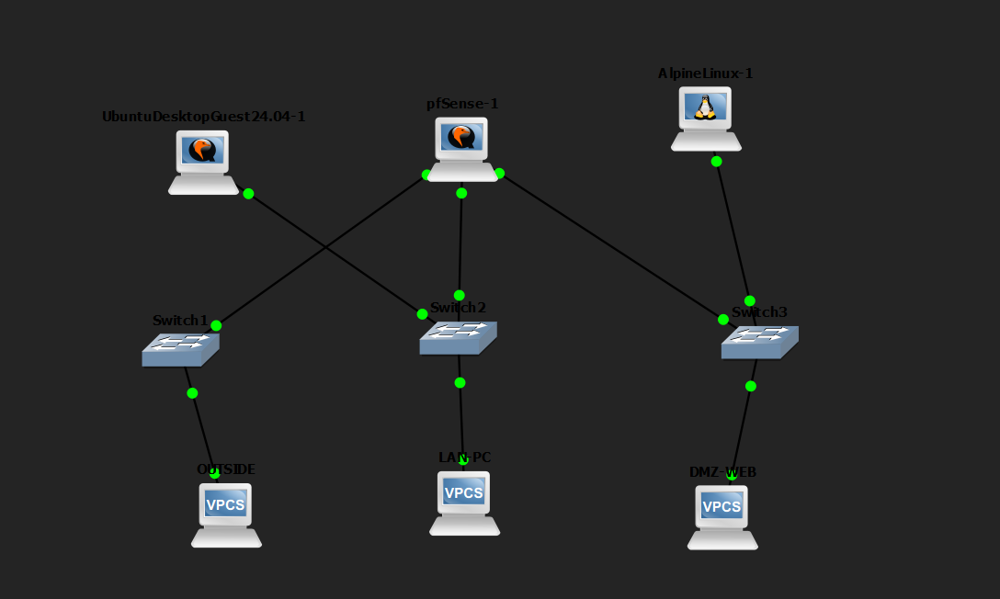
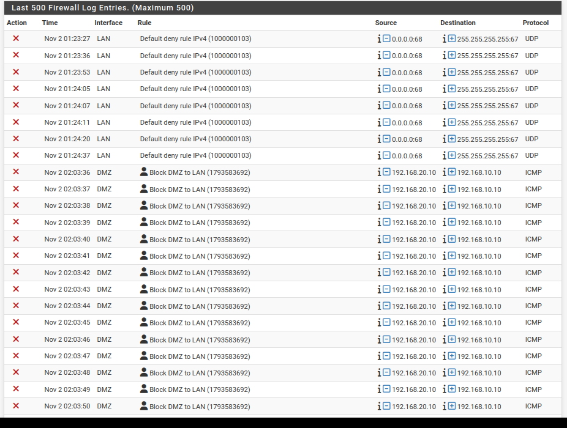

# Lab 10: Stateful Firewall with pfSense (GNS3)

**Duration:** 45-60 min  
**Goal:** Segment LAN, DMZ and WAN with a real pfSense firewall and verify that rules are actually enforced.

## Topology

| Zone | Network | Gateway (pfSense) |
|------|---------|-------------------|
| WAN | 203.0.113.0/24 | 203.0.113.1 |
| LAN | 192.168.10.0/24 | 192.168.10.1 |
| DMZ | 192.168.20.0/24 | 192.168.20.1 |

## Devices

| Device | Zone | IP | Role |
|--------|------|----|------|
| pfSense | WAN/LAN/DMZ | 203.0.113.1 / 192.168.10.1 / 192.168.20.1 | Firewall/Router |
| OUTSIDE (VPCS) | WAN | 203.0.113.10/24 | External client |
| LAN-PC / Alpine (Linux) | LAN | 192.168.10.10 / 192.168.10.20/24 | Internal client |
| DMZ-WEB (VPCS/Host) | DMZ | 192.168.20.10/24 | Public web server |

## Firewall Rules

- **WAN:** Pass TCP 80 to 192.168.20.10 only (configured)
- **LAN:** Allowed to reach other zones by default
- **DMZ:** Blocked to LAN subnets (logged)
- **WAN → LAN:** Blocked by default

## Verification

| Test | Expected | Result |
|------|----------|--------|
| LAN (Alpine/PC) → DMZ ping/HTTP | Allowed | ✅ Success |
| DMZ → LAN ping (192.168.20.10 → 192.168.10.10) | Blocked | ✅ Blocked, seen in firewall logs |
| OUTSIDE → LAN | Blocked | ✅ Timeout |
| OUTSIDE → DMZ ping | Blocked | ✅ Timeout |
| OUTSIDE → DMZ HTTP (TCP 80) | Allowed (rule configured) | ⏳ Not tested (VPCS cannot generate HTTP requests) |

## Firewall Logs

The logs show ICMP packets from `192.168.20.10` to `192.168.10.10` being dropped by the `Block DMZ to LAN` rule on the DMZ interface. This proves the rule is actively enforced.

## Troubleshooting

- **GNS3 VM stuck red / wouldn't start:** Windows Hyper-V was holding CPU virtualization. Disabled Hyper-V/related features and rebooted.
- **pfSense console stayed black on boot:** Switched the console type to VNC to properly view the installer/boot process.
- **Ubuntu appliance wouldn't boot:** Changed `-vga qxl` to `-vga std` in the VM settings.
- **Duplicate IP on DMZ host:** Caused by a reconfiguration mix-up, fixed by correcting the IP on that node.
- **Alpine `wget` errors:** BusyBox `wget` doesn't support `--no-check-certificate`. `ping` to the pfSense LAN IP was enough to prove connectivity.
- **pfSense wizard gateway:** Left WAN upstream gateway empty and unchecked `Block RFC1918 Private Networks` and `Block bogon networks` since we are using RFC1918 addressing in this lab.

## What I learned

- pfSense is a real, stateful firewall. Rules are actually enforced, not just simulated.
- Proper zone segmentation (WAN/LAN/DMZ) drastically limits lateral movement. If the DMZ is compromised, it shouldn't be able to reach the internal LAN.
- The firewall logging is invaluable for proof of enforcement and troubleshooting.
- DHCP/DNS/ARP lessons from previous labs carry over to real firewall design.
- Virtualization conflicts (Hyper-V vs VMware/GNS3) are common and need to be solved at the OS level.
- Testing with the right tools matters. A text-only client can prove reachability, but you need a browser/HTTP client to fully validate web rules.

## Security notes

- **Defense in depth:** VLANs/port-security + DHCP snooping + DAI + a stateful firewall work together.
- **Least privilege:** Only allow the minimum required traffic between zones.
- **Default deny:** Unmatched traffic is denied, which matches what we saw in the logs.
- **DMZ design:** Public-facing services belong in the DMZ, never directly on the LAN.
- **Be careful with trust settings:** Unchecking "Block RFC1918" is only acceptable for isolated lab networks.

## Files

- `topology.png` — GNS3 topology
- `firewall-log.png` — Live logs showing DMZ → LAN blocks
- `README.md` — This lab guide

## Tools

- [GNS3](https://www.gns3.com/)
- [pfSense CE](https://www.pfsense.org/)
- [Alpine Linux](https://alpinelinux.org/)
