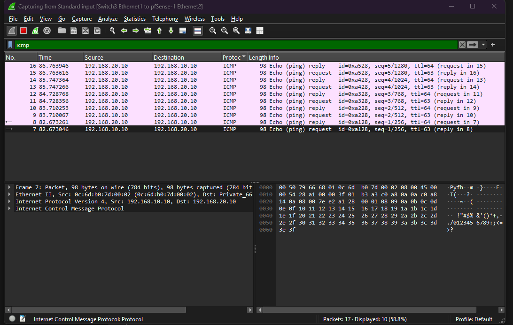
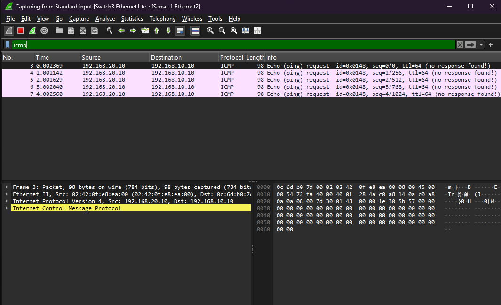
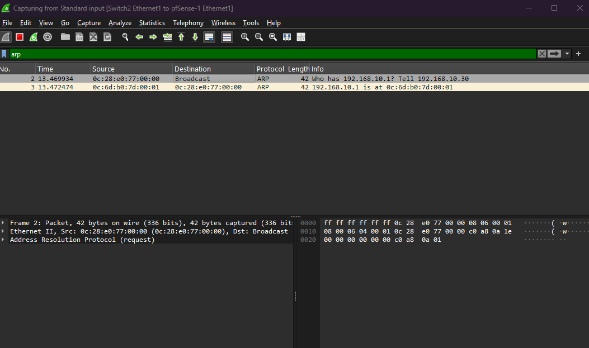
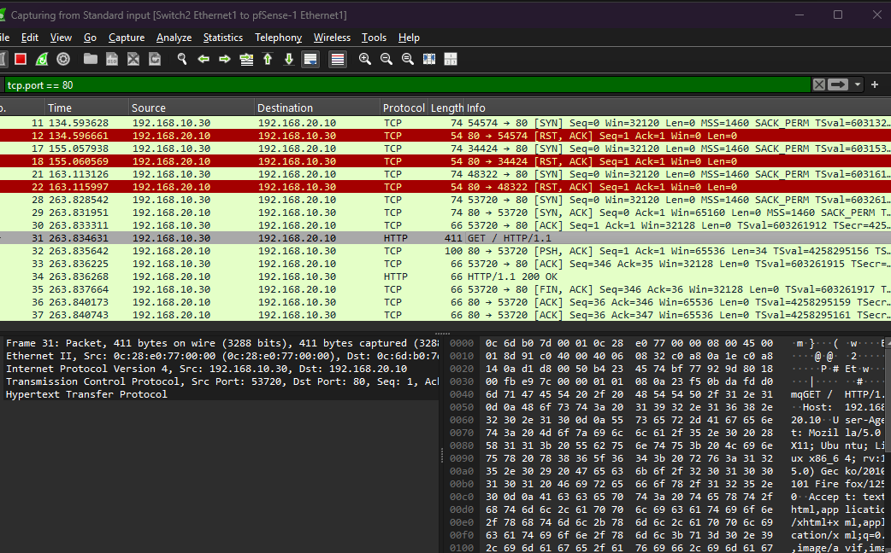
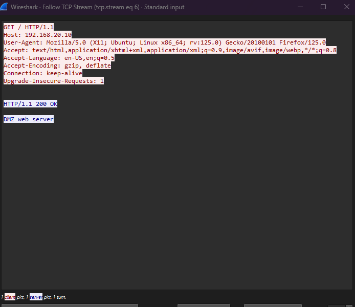

# Lab 11: Packet Analysis with Wireshark (GNS3 + pfSense)

Capture and analyze real traffic crossing a pfSense firewall.

## Goal

Understand what actually crosses each firewall link by capturing packets with
Wireshark, instead of only reading pfSense logs. This lab turns the concepts
from earlier labs (ICMP, ARP, TCP handshake, firewall rules) into real packets.

## Topology

Three pfSense interfaces, one link per zone:

- WAN
- LAN `192.168.10.0/24` (LAN-PC / Ubuntu `192.168.10.30`, gateway `192.168.10.1`)
- DMZ `192.168.20.0/24` (Alpine web server `192.168.20.10`, gateway `192.168.20.1`)

| File | Description |
|------|-------------|
| `lab-11-wireshark.gns3` | GNS3 project |
| `project-files/` | GNS3 runtime files (images, dynamips, vpcs) |
| `topology.png` | Exported topology diagram |
| `firewall logs.png` | pfSense log evidence |

## Theory

### What is Wireshark?

A packet analyzer. It shows every packet crossing a link, like an X-ray for the
network.

### The 3 panes

| Pane | What it shows |
|------|---------------|
| Packet List (top) | One line per packet: time, source, destination, protocol |
| Packet Details (middle) | The packet layer by layer (Ethernet, IP, TCP/UDP, application) |
| Packet Bytes (bottom) | Raw data in hex |

### Display filters (the green bar)

| Filter | Shows |
|--------|-------|
| `icmp` | Ping traffic |
| `arp` | IP-to-MAC questions |
| `tcp.port == 80` | HTTP |
| `ip.addr == 192.168.20.10` | Everything to or from the DMZ web server |
| `tcp.flags.syn == 1 && tcp.flags.ack == 0` | First SYN of each connection |

### The TCP three-way handshake

`SYN -> SYN-ACK -> ACK`. Before any web page loads, these three packets open the
connection.

## Captures

| Capture | Link | Filter | Finding |
|---------|------|--------|---------|
| 1. Allowed ping (LAN -> DMZ) | DMZ | `icmp` | Echo requests and replies in pairs; requests `ttl=63`, replies `ttl=64` |
| 2. Blocked ping (DMZ -> LAN) | DMZ | `icmp` | Five requests, each "(no response found!)", `ttl=64` |
| 3. ARP | LAN | `arp` | "Who has 192.168.10.1? Tell 192.168.10.30" + unicast reply |
| 4. HTTP request + handshake | DMZ | `tcp.port == 80` | SYN, SYN-ACK, ACK, `GET / HTTP/1.1`, `HTTP/1.1 200 OK`, FIN/ACK |
| 4b. Follow TCP Stream | DMZ | `tcp.port == 80` | Full request and "DMZ web server" readable in plain text |

### Screenshots

**Capture 1 — allowed ping (LAN -> DMZ), filter `icmp`**



**Capture 2 — blocked ping (DMZ -> LAN), filter `icmp`**



**Capture 3 — ARP, filter `arp`**



**Capture 4 — HTTP handshake, filter `tcp.port == 80`**



**Capture 4b — Follow TCP Stream (plain-text HTTP)**



## Findings

### Capture 1: allowed ping (LAN -> DMZ)

Requests show `ttl=63`, replies show `ttl=64`. The request started at 64 on the
LAN side and lost 1 crossing pfSense: **one router hop**. Wireshark links the
pairs with "(request in / reply in)".

Rule: `start TTL - received TTL = routers crossed`. `64 - 63 = 1 router`.

### Capture 2: blocked ping (DMZ -> LAN)

Five requests, each marked "(no response found!)", `ttl=64`. That is the
firewall's **Block** rule seen in packets: the requests reach pfSense and
nothing comes back.

The Ethernet source `02:42:0f:e8:ea:00` is a Docker-style MAC, because the
Alpine DMZ host is a Docker container.

### Capture 3: ARP

Two packets:

1. `Who has 192.168.10.1? Tell 192.168.10.30` (broadcast to everyone)
2. `192.168.10.1 is at 0c:6d:b0:7d:00:01` (unicast reply from pfSense LAN)

This is the exact ARP from Lab 1, now in real packets. The pfSense LAN MAC is
`0c:6d:b0:7d:00:01`.

### Capture 4: HTTP and a bonus finding

Three red `[RST, ACK]` rows (134s, 155s, 163s) are earlier failed attempts:
Ubuntu sent a SYN but nothing was listening on port 80 (the `nc` server was
down), so the DMZ host replied RST = "connection refused". A real example of a
rejection-style answer versus a silent Block.

At 263s the full handshake appears: `[SYN] -> [SYN, ACK] -> [ACK]`, then
`GET / HTTP/1.1`, `HTTP/1.1 200 OK`, then FIN/ACK to close.

Follow TCP Stream shows the whole request and the text "DMZ web server" in
plain text — including the User-Agent and headers. That is why HTTP is
insecure.

## Lab tasks (answered)

1. **TTL of the reply in Capture 1?** `64`; the request was `63`. The 1-hop drop
   proves it crossed one router (pfSense), not zero.
2. **Why requests but no replies in Capture 2?** The pfSense Block rule drops
   the packets silently, so no reply ever comes back.
3. **The 3 flags of the handshake, in order?** `SYN`, `SYN-ACK`, `ACK`.

## Quiz (answered)

- **Display filter vs capture filter:** a capture filter decides what Wireshark
  records (set before capturing; everything else is never saved). A display
  filter only hides packets already recorded (the green bar).
- **Why can someone on the path read HTTP but not HTTPS?** HTTPS encrypts the
  content, so a capture shows unreadable data; HTTP is plain text.
- **Which layer holds the MAC and which holds the port?** The MAC is in
  Ethernet II (layer 2); the port is in TCP/UDP (layer 4). ICMP has no ports.
- **Block vs Reject:** Block drops silently, so you see requests with no reply
  (timeout). Reject sends an answer (ICMP "unreachable" or TCP RST), so you see
  a reply saying "refused".

## What I learned

- Wireshark shows the firewall decision from the packet side, not just the log.
- TTL decreases by one per router hop, so it reveals the path length.
- A Block rule looks like requests with no reply; a Reject looks like an RST.
- HTTP is readable on the wire, which is exactly why HTTPS exists.

## Security notes

- HTTP is readable on the wire; HTTPS encrypts it.
- A firewall Block rule shows as requests with no replies.
- Many SYN packets to many ports is the signature of a port scan (Lab 12).
- Capture only networks you own. Never publish `.pcap` files: they can hold
  private data. No capture files are included in this repository.

## Troubleshooting

Captures 2 to 4 initially failed because manual IPs, routes, and the `nc` web
server were lost after restarting the nodes, and Firefox used `https` instead
of `http`. After every restart, the manual addresses and routes must be typed
again:

```bash
# DMZ host (Alpine) — re-add address/route and restart the web server
ip addr add 192.168.20.10/24 dev eth0
ip route add default via 192.168.20.1
while true; do echo -e "HTTP/1.1 200 OK\r\n\r\nDMZ web server" | nc -l -p 80; done &

# LAN host (Ubuntu) — re-add address/route and clear ARP
sudo ip addr add 192.168.10.30/24 dev ens3
sudo ip route add default via 192.168.10.1
sudo ip neigh flush all
```

## Tools

- GNS3 (with integrated Wireshark capture)
- pfSense
- Wireshark

## Next

- Lab 12: attack lab with Kali and nmap, scanning your own DMZ.
- Lab 13: site-to-site VPN between two pfSense firewalls.
